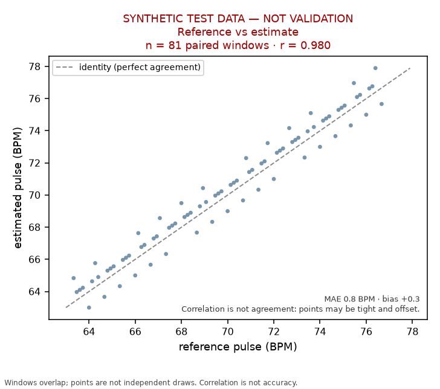
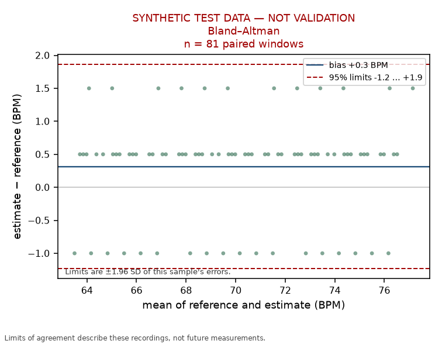
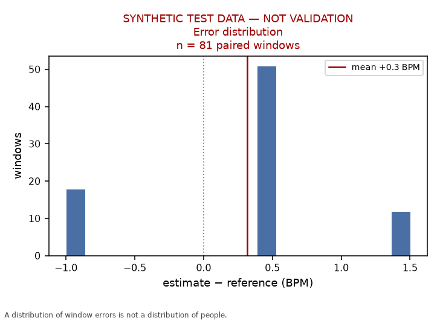
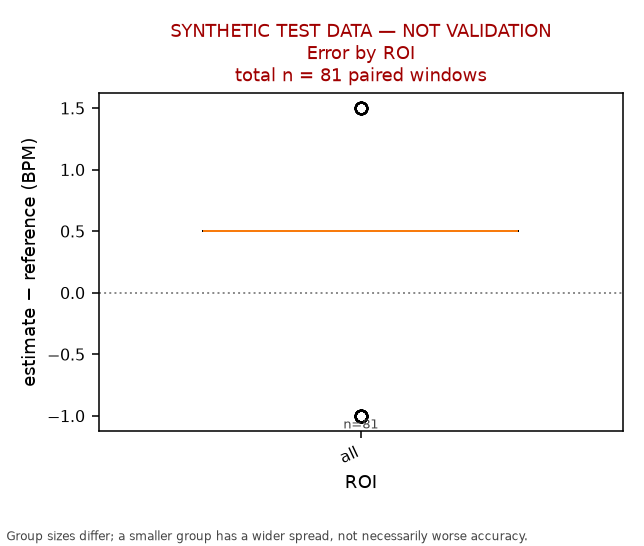
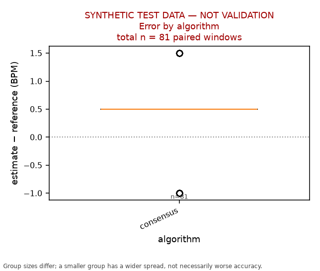
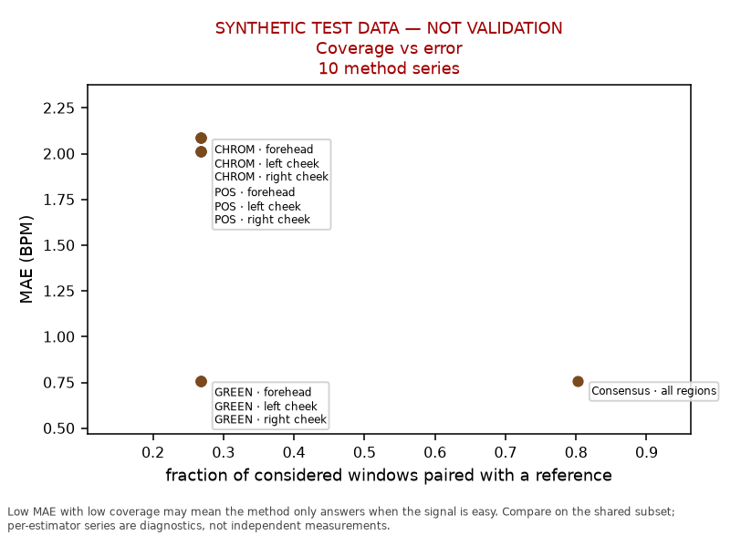
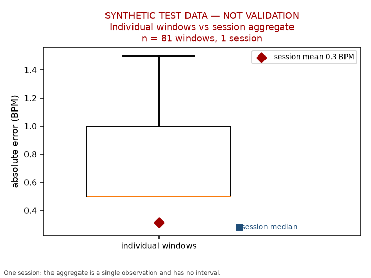

> ## ⚠️ SYNTHETIC TEST DATA — NOT VALIDATION
>
> This report was generated from fixture files created to test the evaluation code. It contains **no participant, no recording and no measured value**. No number below is a result about RSBVP's accuracy.

# RSBVP validation report

- **Schema:** `rsbvp.validation-results.v1` (protocol `sprint17-1`)
- **Generated:** 2026-11-27T02:23:36Z
- **Session source:** `tests/fixtures/validation/synthetic_session_summary_good.json + tests/fixtures/validation/synthetic_session_good.csv`
- **Session id:** `synthetic-fixture-demo`
- **Reference source:** `synthetic_reference_intervals.csv` (intervals layout)
- **Input is synthetic:** **YES**
- **Stratum:** synthetic fixture, no participant

## 1. What this evaluation can and cannot say

The consensus, all-region series was paired with the reference on **81 windows**. Over that subset the mean absolute error is 0.76 BPM with a bias of 0.31 BPM.

Pearson r is 0.980. **That is a correlation, not agreement and not accuracy**: r is invariant to scale and offset, so a method that reads consistently high can correlate almost perfectly.

These numbers describe the paired windows of this session. They are not a claim about RSBVP in general, not a clinical validation, and not evidence about any particular phone.

## 2. Input validation

Worst finding: **info** — 0 blocking, 0 warning, 1 informational.

| Code | Count |
|---|---|
| alignment_summary | 1 |

Input problems are never repaired silently. A blocking finding stops the evaluation, because numbers derived from input that failed its checks cannot be trusted.

## 3. Synchronisation

- **Time base declared:** `capture_start`
- **Offset:** 0.000 s
- **Overlap requirement:** 50% of the shorter span
- **Provenance:** reference_clock_s = window_start_s + (+0.000 s); time base declared as capture_start; reference evaluated over [0.000, 60.000] s

| Alignment | Windows |
|---|---|
| Considered | 81 |
| Paired with a reference | 81 |
| Unmatched (no reference coverage) | 0 |
| Excluded before matching | 0 |

No offset is invented. If the time base is not declared, or no offset is established, the evaluation refuses to run rather than assuming zero.

## 4. Accuracy and agreement

| Statistic | Value |
|---|---|
| Paired observations (n) | 81 |
| Mean absolute error | 0.76 BPM |
| Root mean square error | 0.84 BPM |
| Bias (estimate − reference) | 0.31 BPM |
| Median absolute error | 0.50 BPM |
| Error SD | 0.79 BPM |
| 95% limits of agreement | -1.23 … 1.86 BPM |
| Signed error p05 / p50 / p95 | -1.00 / 0.50 / 1.50 BPM |
| Within ±3 BPM | 100% |
| Within ±5 BPM | 100% |
| MAE bootstrap interval (windows) | 0.68 … 0.85 BPM — **optimistic**, windows are not independent |

Coverage beside the accuracy, because an MAE over a few paired windows describes only those windows:

| Coverage | Value |
|---|---|
| Windows recorded | 101 |
| Accepted by the quality gates | 81 |
| Rejected | 20 |
| Paired with the reference | 81 |
| Independent (non-overlapping) paired | 6 |
| Acceptance rate | 80% |
| Acceptance band | good |
| Density ratio | 1.08 |

## 5. Algorithm and ROI comparison

| Series | n | MAE (BPM) | Bias (BPM) | Coverage |
|---|---|---|---|---|
| Consensus · all regions | 81 | 0.76 | 0.31 | 80% |
| CHROM · forehead | 27 | 2.09 | -2.09 | 27% |
| CHROM · left cheek | 27 | 2.09 | -2.09 | 27% |
| CHROM · right cheek | 27 | 2.09 | -2.09 | 27% |
| GREEN · forehead | 27 | 0.76 | 0.31 | 27% |
| GREEN · left cheek | 27 | 0.76 | 0.31 | 27% |
| GREEN · right cheek | 27 | 0.76 | 0.31 | 27% |
| POS · forehead | 27 | 2.01 | 2.01 | 27% |
| POS · left cheek | 27 | 2.01 | 2.01 | 27% |
| POS · right cheek | 27 | 2.01 | 2.01 | 27% |

### Like-for-like comparison

**CHROM · forehead vs CHROM · left cheek** — verdict: `comparable`

| Figure | Left | Right |
|---|---|---|
| n paired | 27 | 0 / 0 exclusive |
| MAE on own subset | 2.09 | 2.09 |
| MAE on shared subset | 2.09 | 2.09 |

27 shared window(s) (100% of the smaller subset) allow a like-for-like comparison on the shared subset.

**CHROM · forehead vs CHROM · right cheek** — verdict: `comparable`

| Figure | Left | Right |
|---|---|---|
| n paired | 27 | 0 / 0 exclusive |
| MAE on own subset | 2.09 | 2.09 |
| MAE on shared subset | 2.09 | 2.09 |

27 shared window(s) (100% of the smaller subset) allow a like-for-like comparison on the shared subset.

**CHROM · forehead vs Consensus · all regions** — verdict: `comparable`

| Figure | Left | Right |
|---|---|---|
| n paired | 27 | 0 / 54 exclusive |
| MAE on own subset | 2.09 | 0.76 |
| MAE on shared subset | 2.09 | 0.76 |

27 shared window(s) (100% of the smaller subset) allow a like-for-like comparison on the shared subset.

**CHROM · forehead vs GREEN · forehead** — verdict: `comparable`

| Figure | Left | Right |
|---|---|---|
| n paired | 27 | 0 / 0 exclusive |
| MAE on own subset | 2.09 | 0.76 |
| MAE on shared subset | 2.09 | 0.76 |

27 shared window(s) (100% of the smaller subset) allow a like-for-like comparison on the shared subset.

**CHROM · forehead vs GREEN · left cheek** — verdict: `comparable`

| Figure | Left | Right |
|---|---|---|
| n paired | 27 | 0 / 0 exclusive |
| MAE on own subset | 2.09 | 0.76 |
| MAE on shared subset | 2.09 | 0.76 |

27 shared window(s) (100% of the smaller subset) allow a like-for-like comparison on the shared subset.

**CHROM · forehead vs GREEN · right cheek** — verdict: `comparable`

| Figure | Left | Right |
|---|---|---|
| n paired | 27 | 0 / 0 exclusive |
| MAE on own subset | 2.09 | 0.76 |
| MAE on shared subset | 2.09 | 0.76 |

27 shared window(s) (100% of the smaller subset) allow a like-for-like comparison on the shared subset.

**CHROM · forehead vs POS · forehead** — verdict: `comparable`

| Figure | Left | Right |
|---|---|---|
| n paired | 27 | 0 / 0 exclusive |
| MAE on own subset | 2.09 | 2.01 |
| MAE on shared subset | 2.09 | 2.01 |

27 shared window(s) (100% of the smaller subset) allow a like-for-like comparison on the shared subset.

**CHROM · forehead vs POS · left cheek** — verdict: `comparable`

| Figure | Left | Right |
|---|---|---|
| n paired | 27 | 0 / 0 exclusive |
| MAE on own subset | 2.09 | 2.01 |
| MAE on shared subset | 2.09 | 2.01 |

27 shared window(s) (100% of the smaller subset) allow a like-for-like comparison on the shared subset.

**CHROM · forehead vs POS · right cheek** — verdict: `comparable`

| Figure | Left | Right |
|---|---|---|
| n paired | 27 | 0 / 0 exclusive |
| MAE on own subset | 2.09 | 2.01 |
| MAE on shared subset | 2.09 | 2.01 |

27 shared window(s) (100% of the smaller subset) allow a like-for-like comparison on the shared subset.

**CHROM · left cheek vs CHROM · right cheek** — verdict: `comparable`

| Figure | Left | Right |
|---|---|---|
| n paired | 27 | 0 / 0 exclusive |
| MAE on own subset | 2.09 | 2.09 |
| MAE on shared subset | 2.09 | 2.09 |

27 shared window(s) (100% of the smaller subset) allow a like-for-like comparison on the shared subset.

**CHROM · left cheek vs Consensus · all regions** — verdict: `comparable`

| Figure | Left | Right |
|---|---|---|
| n paired | 27 | 0 / 54 exclusive |
| MAE on own subset | 2.09 | 0.76 |
| MAE on shared subset | 2.09 | 0.76 |

27 shared window(s) (100% of the smaller subset) allow a like-for-like comparison on the shared subset.

**CHROM · left cheek vs GREEN · forehead** — verdict: `comparable`

| Figure | Left | Right |
|---|---|---|
| n paired | 27 | 0 / 0 exclusive |
| MAE on own subset | 2.09 | 0.76 |
| MAE on shared subset | 2.09 | 0.76 |

27 shared window(s) (100% of the smaller subset) allow a like-for-like comparison on the shared subset.

**CHROM · left cheek vs GREEN · left cheek** — verdict: `comparable`

| Figure | Left | Right |
|---|---|---|
| n paired | 27 | 0 / 0 exclusive |
| MAE on own subset | 2.09 | 0.76 |
| MAE on shared subset | 2.09 | 0.76 |

27 shared window(s) (100% of the smaller subset) allow a like-for-like comparison on the shared subset.

**CHROM · left cheek vs GREEN · right cheek** — verdict: `comparable`

| Figure | Left | Right |
|---|---|---|
| n paired | 27 | 0 / 0 exclusive |
| MAE on own subset | 2.09 | 0.76 |
| MAE on shared subset | 2.09 | 0.76 |

27 shared window(s) (100% of the smaller subset) allow a like-for-like comparison on the shared subset.

**CHROM · left cheek vs POS · forehead** — verdict: `comparable`

| Figure | Left | Right |
|---|---|---|
| n paired | 27 | 0 / 0 exclusive |
| MAE on own subset | 2.09 | 2.01 |
| MAE on shared subset | 2.09 | 2.01 |

27 shared window(s) (100% of the smaller subset) allow a like-for-like comparison on the shared subset.

**CHROM · left cheek vs POS · left cheek** — verdict: `comparable`

| Figure | Left | Right |
|---|---|---|
| n paired | 27 | 0 / 0 exclusive |
| MAE on own subset | 2.09 | 2.01 |
| MAE on shared subset | 2.09 | 2.01 |

27 shared window(s) (100% of the smaller subset) allow a like-for-like comparison on the shared subset.

**CHROM · left cheek vs POS · right cheek** — verdict: `comparable`

| Figure | Left | Right |
|---|---|---|
| n paired | 27 | 0 / 0 exclusive |
| MAE on own subset | 2.09 | 2.01 |
| MAE on shared subset | 2.09 | 2.01 |

27 shared window(s) (100% of the smaller subset) allow a like-for-like comparison on the shared subset.

**CHROM · right cheek vs Consensus · all regions** — verdict: `comparable`

| Figure | Left | Right |
|---|---|---|
| n paired | 27 | 0 / 54 exclusive |
| MAE on own subset | 2.09 | 0.76 |
| MAE on shared subset | 2.09 | 0.76 |

27 shared window(s) (100% of the smaller subset) allow a like-for-like comparison on the shared subset.

**CHROM · right cheek vs GREEN · forehead** — verdict: `comparable`

| Figure | Left | Right |
|---|---|---|
| n paired | 27 | 0 / 0 exclusive |
| MAE on own subset | 2.09 | 0.76 |
| MAE on shared subset | 2.09 | 0.76 |

27 shared window(s) (100% of the smaller subset) allow a like-for-like comparison on the shared subset.

**CHROM · right cheek vs GREEN · left cheek** — verdict: `comparable`

| Figure | Left | Right |
|---|---|---|
| n paired | 27 | 0 / 0 exclusive |
| MAE on own subset | 2.09 | 0.76 |
| MAE on shared subset | 2.09 | 0.76 |

27 shared window(s) (100% of the smaller subset) allow a like-for-like comparison on the shared subset.

**CHROM · right cheek vs GREEN · right cheek** — verdict: `comparable`

| Figure | Left | Right |
|---|---|---|
| n paired | 27 | 0 / 0 exclusive |
| MAE on own subset | 2.09 | 0.76 |
| MAE on shared subset | 2.09 | 0.76 |

27 shared window(s) (100% of the smaller subset) allow a like-for-like comparison on the shared subset.

**CHROM · right cheek vs POS · forehead** — verdict: `comparable`

| Figure | Left | Right |
|---|---|---|
| n paired | 27 | 0 / 0 exclusive |
| MAE on own subset | 2.09 | 2.01 |
| MAE on shared subset | 2.09 | 2.01 |

27 shared window(s) (100% of the smaller subset) allow a like-for-like comparison on the shared subset.

**CHROM · right cheek vs POS · left cheek** — verdict: `comparable`

| Figure | Left | Right |
|---|---|---|
| n paired | 27 | 0 / 0 exclusive |
| MAE on own subset | 2.09 | 2.01 |
| MAE on shared subset | 2.09 | 2.01 |

27 shared window(s) (100% of the smaller subset) allow a like-for-like comparison on the shared subset.

**CHROM · right cheek vs POS · right cheek** — verdict: `comparable`

| Figure | Left | Right |
|---|---|---|
| n paired | 27 | 0 / 0 exclusive |
| MAE on own subset | 2.09 | 2.01 |
| MAE on shared subset | 2.09 | 2.01 |

27 shared window(s) (100% of the smaller subset) allow a like-for-like comparison on the shared subset.

**Consensus · all regions vs GREEN · forehead** — verdict: `comparable`

| Figure | Left | Right |
|---|---|---|
| n paired | 27 | 54 / 0 exclusive |
| MAE on own subset | 0.76 | 0.76 |
| MAE on shared subset | 0.76 | 0.76 |

27 shared window(s) (100% of the smaller subset) allow a like-for-like comparison on the shared subset.

**Consensus · all regions vs GREEN · left cheek** — verdict: `comparable`

| Figure | Left | Right |
|---|---|---|
| n paired | 27 | 54 / 0 exclusive |
| MAE on own subset | 0.76 | 0.76 |
| MAE on shared subset | 0.76 | 0.76 |

27 shared window(s) (100% of the smaller subset) allow a like-for-like comparison on the shared subset.

**Consensus · all regions vs GREEN · right cheek** — verdict: `comparable`

| Figure | Left | Right |
|---|---|---|
| n paired | 27 | 54 / 0 exclusive |
| MAE on own subset | 0.76 | 0.76 |
| MAE on shared subset | 0.76 | 0.76 |

27 shared window(s) (100% of the smaller subset) allow a like-for-like comparison on the shared subset.

**Consensus · all regions vs POS · forehead** — verdict: `comparable`

| Figure | Left | Right |
|---|---|---|
| n paired | 27 | 54 / 0 exclusive |
| MAE on own subset | 0.76 | 2.01 |
| MAE on shared subset | 0.76 | 2.01 |

27 shared window(s) (100% of the smaller subset) allow a like-for-like comparison on the shared subset.

**Consensus · all regions vs POS · left cheek** — verdict: `comparable`

| Figure | Left | Right |
|---|---|---|
| n paired | 27 | 54 / 0 exclusive |
| MAE on own subset | 0.76 | 2.01 |
| MAE on shared subset | 0.76 | 2.01 |

27 shared window(s) (100% of the smaller subset) allow a like-for-like comparison on the shared subset.

**Consensus · all regions vs POS · right cheek** — verdict: `comparable`

| Figure | Left | Right |
|---|---|---|
| n paired | 27 | 54 / 0 exclusive |
| MAE on own subset | 0.76 | 2.01 |
| MAE on shared subset | 0.76 | 2.01 |

27 shared window(s) (100% of the smaller subset) allow a like-for-like comparison on the shared subset.

**GREEN · forehead vs GREEN · left cheek** — verdict: `comparable`

| Figure | Left | Right |
|---|---|---|
| n paired | 27 | 0 / 0 exclusive |
| MAE on own subset | 0.76 | 0.76 |
| MAE on shared subset | 0.76 | 0.76 |

27 shared window(s) (100% of the smaller subset) allow a like-for-like comparison on the shared subset.

**GREEN · forehead vs GREEN · right cheek** — verdict: `comparable`

| Figure | Left | Right |
|---|---|---|
| n paired | 27 | 0 / 0 exclusive |
| MAE on own subset | 0.76 | 0.76 |
| MAE on shared subset | 0.76 | 0.76 |

27 shared window(s) (100% of the smaller subset) allow a like-for-like comparison on the shared subset.

**GREEN · forehead vs POS · forehead** — verdict: `comparable`

| Figure | Left | Right |
|---|---|---|
| n paired | 27 | 0 / 0 exclusive |
| MAE on own subset | 0.76 | 2.01 |
| MAE on shared subset | 0.76 | 2.01 |

27 shared window(s) (100% of the smaller subset) allow a like-for-like comparison on the shared subset.

**GREEN · forehead vs POS · left cheek** — verdict: `comparable`

| Figure | Left | Right |
|---|---|---|
| n paired | 27 | 0 / 0 exclusive |
| MAE on own subset | 0.76 | 2.01 |
| MAE on shared subset | 0.76 | 2.01 |

27 shared window(s) (100% of the smaller subset) allow a like-for-like comparison on the shared subset.

**GREEN · forehead vs POS · right cheek** — verdict: `comparable`

| Figure | Left | Right |
|---|---|---|
| n paired | 27 | 0 / 0 exclusive |
| MAE on own subset | 0.76 | 2.01 |
| MAE on shared subset | 0.76 | 2.01 |

27 shared window(s) (100% of the smaller subset) allow a like-for-like comparison on the shared subset.

**GREEN · left cheek vs GREEN · right cheek** — verdict: `comparable`

| Figure | Left | Right |
|---|---|---|
| n paired | 27 | 0 / 0 exclusive |
| MAE on own subset | 0.76 | 0.76 |
| MAE on shared subset | 0.76 | 0.76 |

27 shared window(s) (100% of the smaller subset) allow a like-for-like comparison on the shared subset.

**GREEN · left cheek vs POS · forehead** — verdict: `comparable`

| Figure | Left | Right |
|---|---|---|
| n paired | 27 | 0 / 0 exclusive |
| MAE on own subset | 0.76 | 2.01 |
| MAE on shared subset | 0.76 | 2.01 |

27 shared window(s) (100% of the smaller subset) allow a like-for-like comparison on the shared subset.

**GREEN · left cheek vs POS · left cheek** — verdict: `comparable`

| Figure | Left | Right |
|---|---|---|
| n paired | 27 | 0 / 0 exclusive |
| MAE on own subset | 0.76 | 2.01 |
| MAE on shared subset | 0.76 | 2.01 |

27 shared window(s) (100% of the smaller subset) allow a like-for-like comparison on the shared subset.

**GREEN · left cheek vs POS · right cheek** — verdict: `comparable`

| Figure | Left | Right |
|---|---|---|
| n paired | 27 | 0 / 0 exclusive |
| MAE on own subset | 0.76 | 2.01 |
| MAE on shared subset | 0.76 | 2.01 |

27 shared window(s) (100% of the smaller subset) allow a like-for-like comparison on the shared subset.

**GREEN · right cheek vs POS · forehead** — verdict: `comparable`

| Figure | Left | Right |
|---|---|---|
| n paired | 27 | 0 / 0 exclusive |
| MAE on own subset | 0.76 | 2.01 |
| MAE on shared subset | 0.76 | 2.01 |

27 shared window(s) (100% of the smaller subset) allow a like-for-like comparison on the shared subset.

**GREEN · right cheek vs POS · left cheek** — verdict: `comparable`

| Figure | Left | Right |
|---|---|---|
| n paired | 27 | 0 / 0 exclusive |
| MAE on own subset | 0.76 | 2.01 |
| MAE on shared subset | 0.76 | 2.01 |

27 shared window(s) (100% of the smaller subset) allow a like-for-like comparison on the shared subset.

**GREEN · right cheek vs POS · right cheek** — verdict: `comparable`

| Figure | Left | Right |
|---|---|---|
| n paired | 27 | 0 / 0 exclusive |
| MAE on own subset | 0.76 | 2.01 |
| MAE on shared subset | 0.76 | 2.01 |

27 shared window(s) (100% of the smaller subset) allow a like-for-like comparison on the shared subset.

**POS · forehead vs POS · left cheek** — verdict: `comparable`

| Figure | Left | Right |
|---|---|---|
| n paired | 27 | 0 / 0 exclusive |
| MAE on own subset | 2.01 | 2.01 |
| MAE on shared subset | 2.01 | 2.01 |

27 shared window(s) (100% of the smaller subset) allow a like-for-like comparison on the shared subset.

**POS · forehead vs POS · right cheek** — verdict: `comparable`

| Figure | Left | Right |
|---|---|---|
| n paired | 27 | 0 / 0 exclusive |
| MAE on own subset | 2.01 | 2.01 |
| MAE on shared subset | 2.01 | 2.01 |

27 shared window(s) (100% of the smaller subset) allow a like-for-like comparison on the shared subset.

**POS · left cheek vs POS · right cheek** — verdict: `comparable`

| Figure | Left | Right |
|---|---|---|
| n paired | 27 | 0 / 0 exclusive |
| MAE on own subset | 2.01 | 2.01 |
| MAE on shared subset | 2.01 | 2.01 |

27 shared window(s) (100% of the smaller subset) allow a like-for-like comparison on the shared subset.


## 6. Does the session average improve agreement?

| Quantity | Value | n |
|---|---|---|
| Individual window MAE | 0.76 BPM | 81 |
| Individual window |error| p95 | 1.50 BPM | 81 |
| Session mean |error| | 0.31 BPM | 1 |
| Session median |error| | 0.28 BPM | 1 |
| Independent windows | 6 | — |

**Verdict: `averaging_helped`**

The session mean is 0.4 BPM closer to the reference than the average individual window. That is consistent with zero-mean window noise being reduced by averaging; it is not evidence of accuracy beyond this recording. The error changes by -0.1 BPM across the session (slope -0.002 BPM/s). The session mean gives every accepted window equal weight, so a stretch analysed more often contributes more; with a drifting error the mean inherits that stretch's bias rather than describing the whole interval.


Outliers were **not** removed. The session mean includes every accepted window; the median is reported beside it because it is not pulled by a single unusual window. Neither is more correct.

## 7. Stratification

Stratification uses only metadata supplied alongside the reference. Nothing is inferred from the estimates, and absent metadata is labelled unknown.


**By condition**

| condition | n | MAE (BPM) | Bias (BPM) |
|---|---|---|---|
| still_indoor | 81 | 0.76 | 0.31 |

**By device**

| device | n | MAE (BPM) | Bias (BPM) |
|---|---|---|---|
| SYNTHETIC-ref | 81 | 0.76 | 0.31 |

## 8. Findings

- `info` **alignment_summary**: 81 of 81 evaluable window(s) paired (100%)

## 9. Limitations

- Overlapping analysis windows are autocorrelated, so pooled per-window statistics are descriptive of these recordings and are not a population estimate.
- A pooled bootstrap interval resamples windows and is therefore optimistic; only a participant-level resample generalises, and that needs more than one participant.
- Correlation is not agreement and not accuracy. An estimator with a fixed offset can correlate almost perfectly and still be wrong by that offset on every window.
- Agreement with a reference is not clinical validation. These are estimates from consumer cameras compared with another measurement device, not diagnoses.
- Coverage limits every accuracy figure: methods that produce fewer estimates are scored on a smaller, self-selected part of the session unless the shared-subset comparison says otherwise.
- A session average reduces zero-mean window noise only. Correlated error, drift and a changing reference are not reduced by averaging and can make a session mean worse than a typical window.
- No HRV, blood pressure, oxygen saturation or hemoglobin quantity can be inferred from these evaluations; none is computed here.

## 10. Reproducibility

- **Protocol:** `sprint17-1`
- **Python:** 3.11.2 · **numpy:** 2.4.6
- **Bootstrap seed:** 20261127
- **Input digests (SHA-256):**
  - `readings_csv`: `65ccb09dbffa24be34926f904ae226573b779784c9cfa195d1e3d88ac6eedf44`
  - `summary_json`: `1b1c54c74d5e941f7911cca7dc451b8093741e2c7dfa46ad261d8e36e42846d8`
  - `reference_csv`: `70033a8adcdc7d576b64608c76e1d4343d4976f56db0d2fc28edc14c148e9bca`

```python
research.validation.evaluate_session(readings_csv=..., summary_json=..., reference_csv=..., sync=SyncConfig(**sync_settings))
```

Synchronisation settings for that call:

```json
{
  "time_base": "capture_start",
  "offset_s": 0.0,
  "min_overlap_fraction": 0.5,
  "min_window_duration_s": 4.0,
  "evaluate_from_s": null,
  "evaluate_to_s": null,
  "max_reference_variation_fraction": 0.25
}
```

## Figures

Each figure carries its own sample count and limitation. Synthetic figures are marked as such in the figure itself.

### scatter reference vs estimate (n = 81)



### bland altman (n = 81)



### error histogram (n = 81)



### error by roi (n = 81)



### error by algorithm (n = 81)



### coverage vs error (n = 10)



### individual vs session (n = 81)



